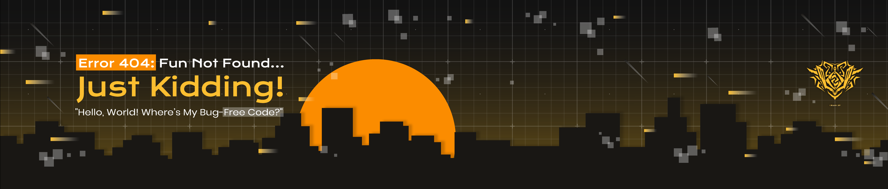

## [;Creative+Technologist+%26+Full-Stack+Developer;Web%2C+Mobile+%26+Interactive+3D%2FAR+Engineering)](https://imycreative.vercel.app/)

Applied Science graduate in **Multimedia Engineering Technology** from **Telkom University** (GPA 3.83/4.00, *Cum Laude*). I build full-stack web and mobile applications, interactive 3D/AR systems, and user-centered interfaces, backed by hands-on experience in enterprise IT operations and technical support.

- **Engineering & Architecture**: Full-stack web and mobile development using **Vue.js, Vite, Flutter (Dart), PostgreSQL, Supabase, and Firebase**.
- **Interactive 3D, AR & Game Systems**: Marker-based and dynamic cloud Augmented Reality, VR simulation, and educational games built with **Unity (C#) and Vuforia Engine**.
- **UI/UX & Operations**: End-to-end interface prototyping in **Figma**, enterprise IT troubleshooting, and software quality assurance (**Black-Box & SUS Usability Testing**).

  
  

---

### GitHub Activity Overview

  

---

### Tech Stack & Tools

  
  
  
  
  
  
  
  
  
  
  
  
  
  
  
  
  

---

### Connect with Me

 

<picture>
  <source media="(prefers-color-scheme: dark)" srcset="https://raw.githubusercontent.com/myusiz3/myusiz3/output/github-snake-dark.svg" />
  <source media="(prefers-color-scheme: light)" srcset="https://raw.githubusercontent.com/myusiz3/myusiz3/output/github-snake.svg" />
  
</picture>
